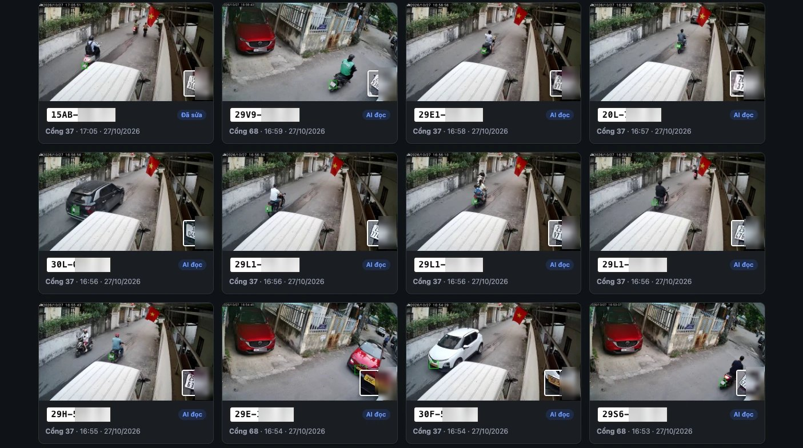
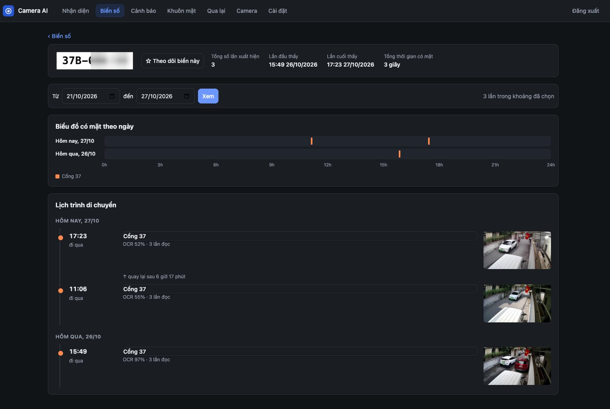
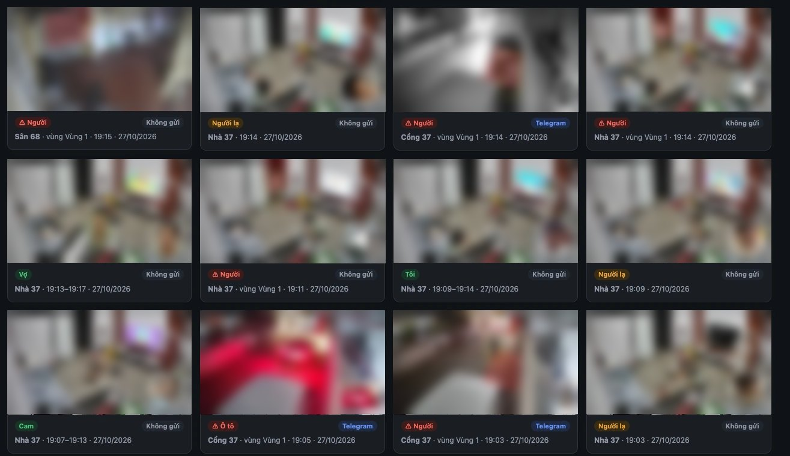
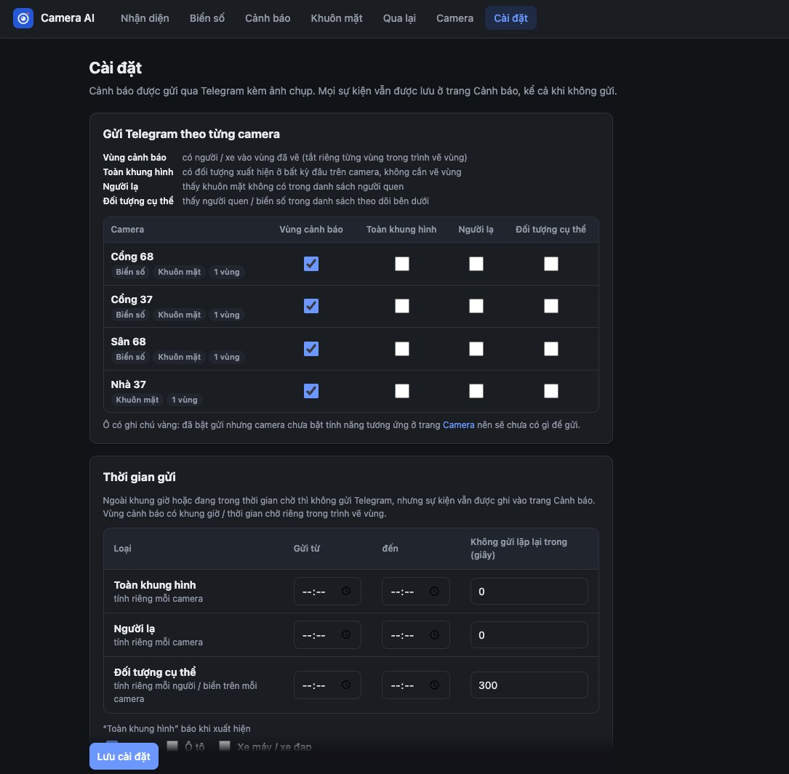

# Camera AI

Hệ thống nhận diện cho camera gia đình, chạy trên một máy Linux trong nhà: **đọc biển số xe Việt Nam**, **cảnh báo theo vùng**, **nhận diện khuôn mặt**, **thống kê người qua lại** (kèm tìm kiếm kiểu “áo trắng”, “xe máy vàng”) và **báo qua Telegram**. Có giao diện web dùng tốt trên điện thoại (cài được như app).

Mọi xử lý hình ảnh chạy trên máy của bạn. AI trên mạng (OpenRouter) là **tuỳ chọn**, chỉ dùng để đọc lại những biển số khó mà máy không đọc ra.

## Ảnh màn hình

> Biển số trong ảnh demo được che một nửa, ảnh camera ở trang Cảnh báo được làm mờ để bảo vệ quyền riêng tư.

**Biển số**: các xe đã đọc được, kèm ảnh biển cắt ra và nguồn đọc (OCR trên máy, AI đọc, người dùng sửa)



**Chi tiết một biển số**: biểu đồ có mặt theo ngày và lịch trình ra vào



**Cảnh báo**: người vào vùng, người lạ, người quen, ô tô… kèm trạng thái đã gửi Telegram hay chưa



**Cài đặt**: chọn loại cảnh báo gửi Telegram cho từng camera, khung giờ gửi



## Tính năng

| Trang | Làm gì |
|---|---|
| **Xem** | Lưới xem trực tiếp mọi camera vừa khít màn hình, phóng to một camera, toàn màn hình; chế độ TV (`?tv=1`) điều khiển bằng phím mũi tên trên remote |
| **Nhận diện** | Dòng thời gian mọi thứ hệ thống thấy: biển số, người quen, người lạ, cảnh báo vùng. Danh sách xe theo biển (xe máy 2 dòng, ô tô), lịch sử ra vào của từng xe, sửa biển đọc sai, đánh dấu biển cần **theo dõi** (báo Telegram mỗi lần xuất hiện) |
| **Cảnh báo** | Vẽ vùng trên hình camera, báo khi có người / xe máy / ô tô / chó mèo đi vào, theo khung giờ. Tìm theo mô tả: “áo trắng”, “ô tô đỏ”, “nữ”, “con chó” |
| **Khuôn mặt** | Thêm ảnh người nhà để nhận ra; người lạ được gom lại để đặt tên sau |
| **Xem lại** | Ghi hình liên tục (file 1 phút, chép nguyên luồng nên gần như không tốn CPU), xem lại trên web / điện thoại với thanh thời gian kéo để tua như app camera, nút **Trực tiếp** xem luồng camera ngay trên trang (độ trễ ~1–2 giây, có tiếng), phát liền mạch qua các phút, lưới ảnh thu nhỏ theo giờ → phút đánh dấu phút có nhiều thay đổi, tua nhanh tới 16×, tải đoạn video; mở thẳng video từ một lần nhận diện / cảnh báo |
| **Camera** | Thêm camera ngay trên web (có hướng dẫn lấy link RTSP từng hãng), bật / tắt tính năng cho từng camera |
| **Cài đặt** | Telegram, giờ gửi cảnh báo, dung lượng tối đa cho video ghi hình, AI, thiết bị đang đăng nhập |
| **Người dùng** | Tài khoản cho người nhà, chọn trang và camera mỗi người được xem; xem thiết bị đang đăng nhập, đăng xuất từ xa hoặc khoá |

Camera dùng được: mọi camera có **RTSP** hoặc **ONVIF**, như Dahua, KBVision, Imou, Hikvision, HiLook, EZVIZ, TP-Link Tapo / VIGI, Reolink, Uniview, kể cả qua đầu ghi. Camera **Xiaomi** dùng được qua [go2rtc](https://github.com/AlexxIT/go2rtc) (đăng nhập tài khoản Xiaomi, xem cuối mục *Thêm camera*).

## Cách hoạt động

```
Camera (RTSP / ONVIF / Xiaomi) ──► go2rtc ──► worker ──► SQLite + ảnh ──► web (FastAPI, PWA)
                                              │  YOLO11n: người, xe          │
                                              │  biển số + OCR               ├─► Telegram
                                              │  khuôn mặt (InsightFace)     │
                                              │  người qua lại (OSNet)       └─► AI OpenRouter (tuỳ chọn)
                                              └─ CLIP: tìm theo mô tả (chạy nền, ưu tiên thấp)
```

- `go2rtc` nhận hình từ camera và phát lại thành RTSP nội bộ, nên mọi hãng camera đều đi chung một đường.
- `worker` chỉ chạy AI khi khung hình có chuyển động, nên camera đứng yên gần như không tốn CPU.
- `recorder` ghi các camera bật "Ghi hình" bằng ffmpeg, chép nguyên luồng (không nén lại) thành file MP4 1 phút trong `LPR_REC_DIR` (mặc định `<LPR_DATA_DIR>/recordings`); vượt dung lượng đặt trong Cài đặt thì xoá file cũ nhất. Mỗi file ghi xong được làm 1 ảnh thu nhỏ (`HH-MM-SS.jpg`, khung thay đổi nhiều nhất) và đo mức thay đổi (`motion.json`), chỉ giải mã khung khoá nên tốn khoảng 1 giây CPU mỗi phút video. Tiếng camera Xiaomi qua go2rtc là 16 kHz nhưng bị khai là 8 kHz; recorder so độ dài tiếng với hình lúc bắt đầu ghi và tự đặt lại tần số cho khớp; khi camera rớt mạng, recorder chèn khoảng lặng cho tiếng (dựa theo giờ nhận gói) để tiếng không đi sớm hơn hình. Video H.265 xem được trên Safari (iPhone, Mac) và Chrome / Edge (Android, Windows, Mac).
- Sáu dịch vụ systemd (chạy bằng user thường, không cần quyền root): `go2rtc`, `lpr-worker`, `lpr-web`, `lpr-ai`, `lpr-search`, `lpr-recorder`.

## Yêu cầu

- Máy Linux chạy liên tục: **Ubuntu 20.04 trở lên** hoặc Debian, CPU **x86_64** (máy ảo cũng được). Script cài có hỗ trợ ARM64 (Raspberry Pi 5, mini PC ARM) nhưng chưa được thử thực tế.
- Tham khảo thực tế: 5 camera (3 camera cổng đọc biển số, ghi hình cả 5) trên máy ảo **8 nhân (i7-8700), 10 GB RAM** dùng trung bình khoảng 35% CPU. Máy 4 nhân chạy được nhưng gần hết CPU lúc đông người, xe qua lại; nên dùng từ 4 nhân trở lên, nhiều camera thì cần mạnh hơn.
- Ổ đĩa: khoảng 3 GB cho phần mềm và model, cộng phần ảnh lưu lại (mặc định giới hạn 1 GB, chỉnh được). Ghi hình thì cần thêm chỗ cho video: camera 4MP H.265 khoảng 10–45 GB mỗi ngày tuỳ bitrate (camera Xiaomi 2K đo được ~14 GB/ngày).
- Máy chủ **cùng mạng** với camera (hoặc nối VPN tới mạng camera).
- Cài `ffmpeg` (`sudo apt install ffmpeg`): cần cho ghi hình, và để tab Camera hiện được ảnh chụp.

## Cài đặt

Trên máy chủ Ubuntu / Debian, đăng nhập bằng user thường (không dùng root) và chạy **một lệnh**:

```bash
curl -fsSL https://raw.githubusercontent.com/tomdo199127/camera-ai-vn/main/deploy/install.sh | bash
```

Script sẽ:
1. Cài gói hệ thống còn thiếu (`git`, `curl`, `ffmpeg`, `python3`). Bước này hỏi mật khẩu sudo.
2. Tải mã nguồn về `~/lpr-server`.
3. Cài [uv](https://github.com/astral-sh/uv), Python 3.12 và các thư viện vào `.venv`, không đụng tới Python của hệ thống.
4. Tải go2rtc và các model AI (`scripts/download_models.sh`). Bước xuất model YOLO tải PyTorch bản CPU khoảng 1 GB vào thư mục tạm rồi xoá đi. Bước này mất vài phút và chỉ làm lần đầu.
5. Tạo `.env` và `go2rtc/go2rtc.yaml` từ file mẫu, rồi bật và chạy 6 dịch vụ.
6. Bật tự chạy sau khi khởi động máy (`loginctl enable-linger`, hỏi sudo).

Cài xong, mở web tại `http://<IP máy chủ>:8080` và đăng nhập bằng tài khoản mặc định:

| Tài khoản | Mật khẩu |
|---|---|
| `admin` | `123456Aa@` |

> **Đổi mật khẩu ngay sau khi đăng nhập lần đầu** (menu **Thêm → Đổi mật khẩu**), nhất là trước khi mở cho xem từ xa. Ai biết mật khẩu mặc định đều xem được camera của bạn. Thêm tài khoản cho người nhà ở **Thêm → Người dùng**: chọn được trang và camera mỗi người được xem.

Nếu máy bật tường lửa `ufw`, mở cổng web cho mạng trong nhà:

```bash
sudo ufw allow from 192.168.1.0/24 to any port 8080 proto tcp
```

Muốn tự tải mã về trước thì `git clone https://github.com/tomdo199127/camera-ai-vn.git ~/lpr-server` rồi chạy `bash ~/lpr-server/deploy/install.sh`, kết quả như nhau.

## Thêm camera

Vào **Camera → + Thêm camera**, chọn hãng, điền IP, tài khoản, mật khẩu, bấm **Thử kết nối** để xem ảnh rồi **Thêm camera**. Form có hướng dẫn riêng cho từng hãng. Tóm tắt:

| Hãng | Tài khoản / mật khẩu | Link RTSP (luồng chính) |
|---|---|---|
| Dahua, KBVision, đầu ghi Dahua | tài khoản tạo lúc khởi tạo camera | `rtsp://user:pass@IP:554/cam/realmonitor?channel=1&subtype=0` |
| Imou | `admin` / **Safety code** trên tem camera | như Dahua |
| Hikvision, HiLook | tài khoản lúc kích hoạt (Hik-Connect / SADP) | `rtsp://user:pass@IP:554/Streaming/Channels/101` |
| EZVIZ | `admin` / **mã xác minh** trên tem | `rtsp://admin:MA@IP:554/Streaming/Channels/101` |
| TP-Link Tapo | **Tài khoản camera** tạo trong app Tapo | `rtsp://user:pass@IP:554/stream1` |
| Reolink | tài khoản camera, bật RTSP trong cài đặt | `rtsp://user:pass@IP:554/h264Preview_01_main` |
| Uniview | tài khoản camera | `rtsp://user:pass@IP:554/unicast/c1/s0/live` |
| Hãng khác | thử ONVIF: `onvif://user:pass@IP:80` | hoặc dán link RTSP đầy đủ |

Mẹo:
- Đặt **IP tĩnh** cho camera trên router để link không bị đổi.
- Camera dùng để **đọc biển số** nên dùng **luồng chính**. Camera chỉ để cảnh báo vùng hoặc đếm người qua lại có thể dùng luồng phụ cho nhẹ máy.
- Camera đọc biển số tốt nhất khi nhìn **chéo dưới 30°** vào chỗ xe đi chậm (cổng), cách 4–8 m, chụp nhanh (shutter 1/250 trở lên) để ban đêm biển không bị nhoè.

**Camera Xiaomi** không có RTSP. Mở giao diện go2rtc qua SSH tunnel (`ssh -L 1984:127.0.0.1:1984 <máy chủ>` rồi vào `http://127.0.0.1:1984`), chọn *Add → Xiaomi*, đăng nhập tài khoản Mi Home và thêm camera. go2rtc ghi vào `go2rtc/go2rtc.yaml`, camera tự hiện trong tab Camera của web. Hệ thống tự khởi động lại go2rtc khi luồng Xiaomi bị treo.

## Telegram

1. Tạo bot với [@BotFather](https://t.me/BotFather), lấy **token**.
2. Thêm bot vào nhóm Telegram của gia đình (hoặc nhắn trực tiếp cho bot), gửi một tin bất kỳ.
3. Vào **Cài đặt → Kết nối Telegram**, dán token, bấm **Tự lấy chat ID**, rồi **Gửi thử**.

Chọn loại cảnh báo gửi cho từng camera, khung giờ gửi và khoảng cách giữa hai lần gửi trong cùng trang.

## AI trên mạng (tuỳ chọn)

Biển số nhỏ, nghiêng, xe chạy nhanh mà máy không đọc ra có thể nhờ một model AI đọc lại.

1. Tạo key ở [openrouter.ai](https://openrouter.ai/settings/keys) và **đặt giới hạn chi tiêu** cho key.
2. **Cài đặt → Trợ lý AI**: dán key, bấm *Tải danh sách*, chọn model.
3. Chọn AI dùng cho việc gì. Mặc định chỉ bật *đọc biển số máy không đọc ra*.

Gợi ý từ thử nghiệm thực tế trên biển số Việt Nam: model đọc biển `google/gemini-3.1-flash-lite` (đọc đúng nhất, khoảng $0.0008 mỗi lần), model so người `z-ai/glm-5.3-flash` (rẻ nhất). Hệ thống tự bỏ qua ảnh quá mờ (mức chỉnh được) và xe đang đỗ, nên không gọi AI thừa. Chi phí hôm nay hiện ngay trong trang Cài đặt.

Chỉ ảnh cắt biển số (và ảnh người khi so người) được gửi đi. Khuôn mặt và cảnh báo vùng luôn xử lý trên máy.

## Xem từ xa

Không nên mở cổng trên router. Hai cách an toàn:

- **[Tailscale](https://tailscale.com)** (khuyên dùng, miễn phí cho cá nhân): cài trên máy chủ và điện thoại, mở `http://<tên máy trong Tailscale>:8080`.
- **ngrok** (có tên miền https cố định miễn phí): cài ngrok, lưu authtoken (`ngrok config add-authtoken …`), ghi `NGROK_DOMAIN=<tên miền của bạn>` vào `~/lpr-server/.ngrok.env`, rồi:
  ```bash
  cp deploy/lpr-ngrok.service ~/.config/systemd/user/
  systemctl --user daemon-reload && systemctl --user enable --now lpr-ngrok
  ```
  Web có trang đăng nhập riêng, khoá tạm thời sau nhiều lần nhập sai mật khẩu.

## Vận hành

```bash
# cập nhật lên bản mới (cấu hình, dữ liệu, camera giữ nguyên): chạy lại đúng lệnh cài
curl -fsSL https://raw.githubusercontent.com/tomdo199127/camera-ai-vn/main/deploy/install.sh | bash

# xem trạng thái, nhật ký
systemctl --user status go2rtc lpr-worker lpr-web lpr-ai lpr-search lpr-recorder
journalctl --user -u lpr-worker -f
```

- **Dữ liệu** (SQLite + ảnh) nằm ở `LPR_DATA_DIR` trong `.env` (mặc định `~/lpr-server/data`). Sao lưu thư mục này là đủ. Ảnh cũ hơn `LPR_RETENTION_DAYS` ngày, hoặc vượt `LPR_MAX_IMAGES_MB`, được tự xoá.
- **Camera báo “Mất kết nối”**: thử link bằng VLC trên máy cùng mạng; kiểm tra IP camera có đổi không (dùng **Đổi link** trên thẻ camera).
- **CPU cao**: tắt bớt tính năng ở camera không cần (khuôn mặt, người qua lại), dùng luồng phụ cho camera không đọc biển số.
- Các ngưỡng nhận diện chỉnh trong `.env` (xem `.env.example`), sau đó `systemctl --user restart lpr-worker`.

## Giấy phép

Mã nguồn phát hành theo giấy phép **MIT** (xem [LICENSE](LICENSE)). Giấy phép này chỉ áp dụng cho mã nguồn trong repo, không áp dụng cho các model AI bên dưới.

## Model và giấy phép của model

Model được tải từ nguồn gốc lúc cài, **không** nằm trong repo. Mỗi model có giấy phép riêng, hãy đọc trước khi dùng, nhất là khi dùng cho mục đích thương mại:

| Model | Dùng cho | Nguồn | Giấy phép |
|---|---|---|---|
| YOLO11n | phát hiện người, xe | [Ultralytics](https://github.com/ultralytics/ultralytics) | AGPL-3.0 |
| YOLOv9 biển số | tìm biển số | [open-image-models](https://github.com/ankandrew/open-image-models) | MIT |
| RapidOCR (PaddleOCR) | đọc chữ trên biển | [RapidOCR](https://github.com/RapidAI/RapidOCR) | Apache-2.0 |
| InsightFace buffalo_sc | khuôn mặt | [InsightFace](https://github.com/deepinsight/insightface) | **chỉ phi thương mại** |
| OSNet x1.0 | người qua lại | [Qualcomm AI Hub](https://github.com/quic/ai-hub-models) | MIT |
| CLIP ViT-B/32 (int8) | tìm theo mô tả | [Xenova/clip-vit-base-patch32](https://huggingface.co/Xenova/clip-vit-base-patch32) | MIT |
| go2rtc | nhận luồng camera | [AlexxIT/go2rtc](https://github.com/AlexxIT/go2rtc) | MIT |

## Quyền riêng tư

Biển số và khuôn mặt là **dữ liệu cá nhân**. Chỉ lắp camera trong phạm vi nhà mình, cho người trong nhà biết hệ thống đang chạy, và tuân thủ quy định về bảo vệ dữ liệu cá nhân nơi bạn sống (ở Việt Nam là Nghị định 13/2023/NĐ-CP). Dữ liệu chỉ nằm trên máy của bạn, trừ ảnh gửi Telegram và ảnh biển số gửi AI nếu bạn bật.
